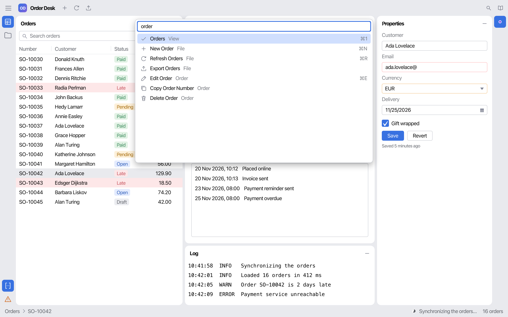
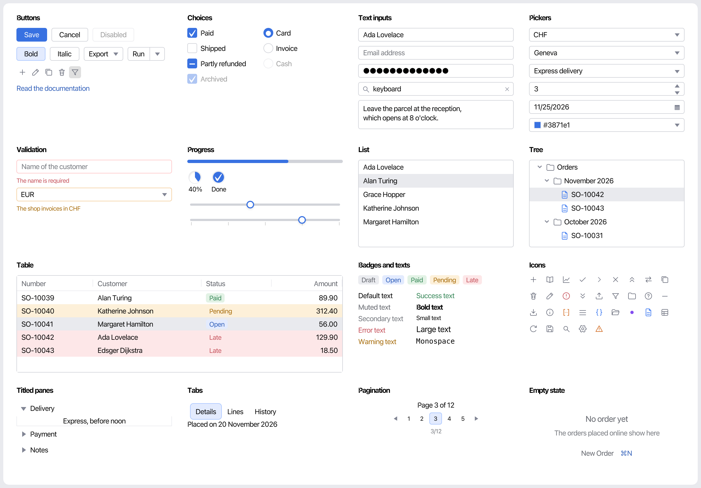
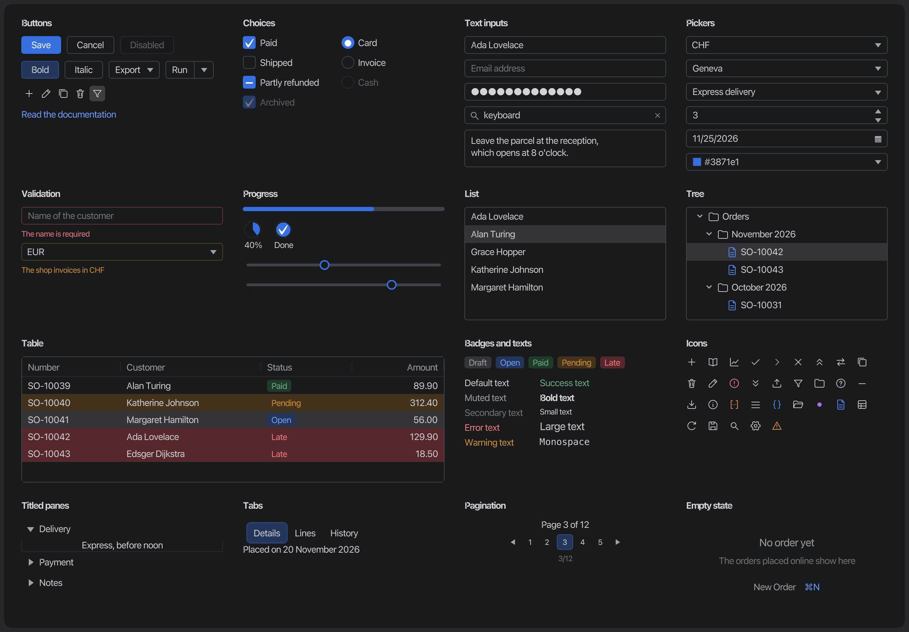

# Islands FX


[](https://maven-badges.sml.io/sonatype-central/com.chavaillaz/islands-fx)
[](https://opensource.org/licenses/Apache-2.0)

Light and dark themes for JavaFX applications, and the workbench of their main window: its toolbar standing in the
title bar, its content and tool windows in rounded islands.


- **Workbench**: the main toolbar standing in the title bar of the window, beside the buttons of the operating system,
  the tool windows docked in rounded islands beside the content or under it, their buttons on stripes along the sides,
  and the status bar with its breadcrumbs. The main menu stands in the menu bar of macOS, and elsewhere in a menu
  opened by the first button of the main toolbar. Notifications show over the window, a search finds any action, and
  the window opens as the user left it.
- **Themes**: a light and a dark one, or the one following the appearance of the operating system, applied to every
  window of the application, its dialogs included, with the standard controls of JavaFX styled flat to match. An
  application derives its own from them, and chooses their accent color.
- **Actions**: what the user can do, described once and shown as menu items, toolbar buttons or tool window buttons
  that follow whether it is enabled or selected, its shortcut working wherever the focus stands in the window.
- **Controls**: a badge, an empty state and a search field, the rows of tables tinted after a tone, the inputs failing
  validation marked, and style classes for the texts.
- **Icons**: outlines drawn on a grid of 16 pixels and colored by the theme, to which an application adds its own.

It is not a framework: an application keeps its own structure, controllers and FXML, and builds its main window from
these parts.

## Requirements

- **Java 25** or later
- **JavaFX 27** or later, which the application provides: the title bar of the window is a `HeaderBar` of JavaFX 27

## Installation

The dependency is available in Maven Central, along with JavaFX, which the application provides:

```xml
<dependency>
    <groupId>com.chavaillaz</groupId>
    <artifactId>islands-fx</artifactId>
    <version>1.0.0</version>
</dependency>
<dependency>
    <groupId>org.openjfx</groupId>
    <artifactId>javafx-controls</artifactId>
    <version>27.0.1.1</version>
</dependency>
```

On the module path, the library is the module `com.chavaillaz.fx.islands`, which requires JavaFX, the preferences API
of Java (`java.prefs`) and the JSpecify API transitively:

```java
requires com.chavaillaz.fx.islands;
```

The module of JSpecify is then needed at run time as well, which the dependency brings: an application declaring
JSpecify itself keeps it in the `compile` scope, the `provided` one leaving it out of the run, which then fails.

### Snapshots

Every push to `master` passing the code quality checks publishes its snapshot, under the version of its POM, to
[GitHub Packages](https://github.com/chavaillaz/islands-fx/packages), for an application to try a change before
its release. Maven downloads the latest build of that version once it looks for a newer one: once a day, or at
every build run with `-U`. GitHub asks for a token to download from it, even for a public package: a personal
access token (classic) with the `read:packages` scope, which goes in the settings of Maven (`~/.m2/settings.xml`)
under the identifier of the repository the application declares:

```xml
<repository>
    <id>github-islands-fx</id>
    <url>https://maven.pkg.github.com/chavaillaz/islands-fx</url>
    <releases>
        <enabled>false</enabled>
    </releases>
</repository>
```

```xml
<server>
    <id>github-islands-fx</id>
    <username>YOUR_GITHUB_USERNAME</username>
    <password>YOUR_TOKEN</password>
</server>
```

## Showcase

The showcase is the main window of an application taking orders, laid out by the workbench, and a gallery of the
controls of JavaFX and of the library, each in its usual states, in the theme the user chooses in its menus. It stands
among the tests, from which a clone of the repository opens it:

```shell
mvn -Pshowcase
```







## Usage

### The main window

```java
@Override
public void start(Stage stage) {
    ThemeManager themes = new ThemeManager(ThemeMode.SYSTEM);
    themes.install();

    Workbench workbench = new Workbench();
    workbench.getMainToolbar().getLeftItems().add(new TitleWidget("Record Explorer"));
    workbench.addToolWindow(ToolWindow.builder("records", "Records", Icons.RECORDS, recordsTable)
            .accelerator(KeyCombination.keyCombination("Shortcut+1"))
            .build());
    workbench.setContent(detailsTree);
    workbench.getStatusBar().getPath().setAll("Records", "SO-10042");
    workbench.setMainMenu(ActionMenus.createMenus(List.of(
            ActionGroup.of("View", workbench.getToolWindows().getFirst().getToggleAction(), themes.createMenu()))));

    Scene scene = workbench.createScene(stage);
    themes.apply(scene);
    stage.show();
}
```

`createScene` gives the stage the `EXTENDED` style, its main toolbar standing in the title bar, and is called before
the stage shows. The `ThemeManager` applies the theme to the windows opened afterwards, dialogs included, and
`themes.apply(scene)` applies it to the main window before it shows, so that it never shows unthemed.

The main menu stands in the menu bar of macOS, and elsewhere in a menu opened by the first button of the main toolbar.
An application keeping it in the main toolbar on macOS as well creates its workbench with
`new Workbench(MainMenuPlacement.MAIN_TOOLBAR)`.

A tool window docks on the left, unless told otherwise: on the right, or under the content, where one shows at a time,
such as a log or the output of a task (`.anchor(ToolWindowAnchor.BOTTOM)`), its button at the bottom of the left
stripe. Its title and actions can change once docked (`setTitle`, `getActions()`), such as a count of what it lists,
its header, button and menu items following. The workbench gives the tool window docked under an identifier
(`getToolWindow("records")`), and undocks one (`removeToolWindow`), its island, button and shortcuts leaving the window.

A tool window the user shows, through its button, menu item or shortcut, takes the focus, and gives it back to the
content once hidden. The escape key in a tool window gives the focus back to the content, the tool window staying
shown, and `Shift+Escape` hides it as well. Showing it from the code, such as when restoring the tool windows the user
left showing, leaves the focus where it stands.

The content can be headed by a `ContentHeader`, a tab naming what it shows beside the buttons of its actions, and the
status bar can tell how a task of the application stands with a `TaskStatus`, which follows a `Task` of JavaFX by
itself:

```java
ContentHeader header = new ContentHeader("SO-10042", Icons.RECORD);
header.getActions().setAll(expandAll, collapseAll);

TaskStatus loading = new TaskStatus();
workbench.getStatusBar().getWidgets().add(loading);
loading.follow(loadTask);
```

The items an application opens side by side show in `ContentTabs`, a tab pane whose tabs look as those of an editor:
a tab closes by its button, showing on the tab under the mouse and the one selected, or by a click of the middle
button, and moves by dragging, the buttons of the actions applying to the content standing at the end of the row:

```java
ContentTabs tabs = new ContentTabs(new Tab("SO-10042", detailsOf(order)));
tabs.getActions().setAll(edit, copy, delete);
workbench.setContent(tabs);
```

`tabs.close(tab)` closes a tab as its button does, its close request handler able to keep it open, such as from an
action closing the item selected.

The workbench shows notifications in balloons over the bottom right corner of the window: they go away by
themselves, or stay until closed for a warning or a danger, and offer links to their actions:

```java
workbench.showNotification(Notification.builder(Tone.DANGER, "Could not load the records")
        .text(exception.getMessage())
        .actions(retry)
        .build());
```

The window opens as the user left it, its bounds, its tool windows and the theme chosen kept in the preferences of
the application, once the tool windows are docked and before the stage shows:

```java
new WorkbenchState(Preferences.userNodeForPackage(App.class)).manage(stage, workbench, themes);
```

### Actions

```java
Action refresh = Action.builder("records.refresh", "Refresh")
        .description("Loads the records again")
        .icon(Icons.REFRESH)
        .accelerator(KeyCombination.keyCombination("Shortcut+R"))
        .disabled(loading)
        .handler(model::refresh)
        .build();

ButtonBase button = ActionButtons.create(refresh);    // a borderless toolbar button
MenuItem item = ActionMenus.createItem(refresh);      // a menu item, with its shortcut
```

A toggle action is given the state it shows with `selected(...)`, its handler changing that state: it is shown as a
check menu item or a toggle button. Its text and description can follow values as well (`text(...)`,
`description(...)`), which the menu items, buttons and links showing it follow.

The shortcut of an action works wherever the focus stands in the window once the workbench knows the action: those
of its tool windows and of its main menu, and those the application registers, such as the actions of its own
toolbars:

```java
workbench.registerActions(refresh, save);
```

The actions of a view the application closes are forgotten with `unregisterActions`, their shortcuts then stopping.

`Shortcut+Shift+A` opens the search of these actions over the window: the words typed list the actions whose text,
menu or description holds them, the best matches first, and the enter key performs the one selected. The action
opening it, `workbench.getSearchAction()`, can stand in a menu or a toolbar as well.

### Icons

The icons of the library are the constants of `Icons`. An application adds its own with an enumeration implementing
`Icon`, each constant giving an SVG path drawn on a grid of 16 by 16 pixels:

```java
public enum AppIcons implements Icon {
    HISTORY("M8 4.5V8l2.5 1.5M14 8a6 6 0 1 1-12 0a6 6 0 1 1 12 0z");

    private final String path;

    AppIcons(String path) {
        this.path = path;
    }

    @Override
    public String path() {
        return path;
    }
}
```

An icon is stroked in the color of `-icon-default`, which its style class, `icon-` followed by its name in lowercase
(`icon-history`), can change.

### Controls

A few controls complete those of JavaFX: a `Badge`, a short text tinted after its tone such as the status of a
record, an `EmptyState`, what an area shows while it has nothing to show, with links to the actions filling it, and a
`SearchField`, a text field between a magnifier and a button clearing it, as the escape key does. Like the widgets of
the workbench, they are controls of JavaFX: an application changes them through their properties, their parts
standing in a skin, which a stylesheet can replace (`-fx-skin`).

The rows of a table are tinted after the tone of their item, the row under the mouse and the selection still showing
over the tint:

```java
orders.setRowFactory(ToneRows.forTable(order -> order.isLate() ? Tone.DANGER : null));
```

### FXML

The controls of the library can be declared in FXML, an icon by the name of one of the `Icons`, or with
`fx:constant` for one of the application:

```xml
<TitleWidget title="Record Explorer"/>
<IconView icon="SAVE" size="20"/>
<Badge text="Paid" tone="SUCCESS"/>
<EmptyState title="No record selected" text="Select a record to see its details here"/>
<Button fx:id="saveButton" text="Save"/>
```

A button an FXML file declares looks as the buttons of actions once decorated, its text moving to its tooltip:

```java
ActionButtons.decorate(saveButton, Icons.SAVE);
```

### Validation

An input the user filled in wrong is marked by `Validation`: its outline takes the color of the problem, stronger
while it has the focus, and its tooltip tells the problem, until the mark is cleared:

```java
name.textProperty().subscribe(text -> {
    if (text.isBlank()) {
        Validation.setError(name, "The name is required");
    } else {
        Validation.clear(name);
    }
});
```

A warning (`setWarning`) marks a value that is doubtful rather than wrong. The marks are the pseudo-classes `:error`
and `:warning`, which the stylesheets of an application can use as well.

### Themes

The `ThemeManager` applies the light theme or the dark one, as the user chooses in the menu it creates, or as the
operating system shows. An application gives its own theme for either, derived from one of the library by a
stylesheet overriding some of its colors, and changes the accent color, such as to the one of the operating system:

```java
themes.setDarkTheme(Theme.DARK.derive("contrast", App.class.getResource("contrast.css").toExternalForm()));
themes.accentProperty().bind(Platform.getPreferences().accentColorProperty());
```

### Style classes

Lists, trees, tables and tree tables are framed as text fields are, unless they fill an island, which frames them
already: the content of the window, a tool window, or a tab of `ContentTabs`. A few style classes, which the nodes of
an application take, change how the themes style them:

| Style class                                  | Given to                  | Makes it                                  |
|----------------------------------------------|---------------------------|-------------------------------------------|
| `edge-to-edge`                               | a list, a tree or a table | unframed, deep in an island               |
| `align-right`                                | a column of a table       | aligned on the right, its header included |
| `text-muted`, `text-secondary`               | a label or a text         | less prominent                            |
| `text-error`, `text-warning`, `text-success` | a label or a text         | colored after how things stand            |
| `text-bold`, `text-small`, `text-large`      | a label or a text         | bold, smaller or larger                   |
| `monospace`                                  | a label or a text         | in the monospaced font of the system      |

### Colors

The stylesheets of an application can use the colors of the themes, which every theme defines under the same names:

| Color                                                           | Stands for                                          |
|-----------------------------------------------------------------|-----------------------------------------------------|
| `-main-window-bg`, `-island-bg`, `-island-border`               | the window behind the islands, an island, its lines |
| `-text-default`, `-text-muted`, `-text-secondary`, `-text-link` | text, from the most to the least prominent          |
| `-text-error`, `-text-warning`, `-text-success`                 | text telling an error, a warning, or a success      |
| `-text-disabled`, `-text-over-accent`                           | text disabled, or over the accent                   |
| `-accent`, `-selection-active`, `-selection-inactive`           | the accent, the selection of a focused list or not  |
| `-icon-default`, `-icon-muted`, `-icon-blue`, `-icon-orange`    | the strokes of icons                                |
| `-badge-success-bg`, `-badge-danger-bg`, and their `-text`      | the tints of badges, such as the rows of a status   |
| `-control-error-border`, `-control-warning-border`              | the outline of an input failing validation          |

```css
.table-row-cell:invalid {
    -row-tint: -badge-danger-bg;
}
```

A row is painted with `-row-tint`, which a stylesheet changes rather than its background, so that the row under the
mouse and the selection still show over it.

### Languages

The texts the library shows, such as the theme menu or the tooltips of its buttons, are in English, French or
German, after the language of the display (`Locale.Category.DISPLAY`), and in English for any other language.

## Contributing

A feature request or a bug report is welcome as an issue, and a change as a pull request from a fork.

The build needs **JDK 25 or later** and Maven 3.9 or later, and says so on an older one. Everything it checks runs
with:

```shell
mvn verify
```

A change is ready once that passes, which takes:

- **Tests covering it.** They assert with [AssertJ](https://assertj.github.io/doc/), and each is named by a
  sentence saying what the library does (its `@DisplayName`). The controls are tested on the headless platform of
  JavaFX, which needs no display. A test still running after a minute fails, and so does a test styling controls
  once JavaFX records a CSS error, such as a color no theme defines.
- **Imports in order**, which Checkstyle verifies (see [checkstyle.xml](checkstyle.xml)): the static ones,
  then those of `java`, `javax` and `jakarta`, then those of third parties, then those of `com.chavaillaz`,
  each group sorted alphabetically and separated from the next by a blank line, with no star import and none
  left unused.
- **No compiler warning.** Every check of the compiler is on (`-Xlint:all`), and a warning fails the build,
  on JDK 25 as on any later one, whose compiler adds checks of its own.
- **Dependency versions converging.** Two dependencies asking for different versions of a third one, the test
  ones included, fail the build, rather than Maven taking whichever it reaches first: the version is then managed
  in the POM, the newest one asked for unless something rules it out.

Every pull request, and every push to `master`, is built that way on Java 25 and on every later long-term
support version, with the coverage of the tests measured, and failing once they cover less than 80% of the lines
or of the branches of the library: `mvn clean -Pcoverage verify` writes the same report to `target/site/jacoco`,
the `clean` keeping the data of an earlier build out of it.

The screenshots of this page are renders of the showcase on the headless platform of JavaFX, which its test writes
once given their folder. A change to the look renders them again with:

```shell
mvn test -Dtest=ShowcaseTest -Dshowcase.screenshots=docs/screenshots
```

### Releasing

A release is made by the maintainer, from a clean working tree: `sh release.sh` asks for the version, sets it
in the POM and in the dependency this page shows, and pushes that commit as a tag of the same name. `master`
then takes the README naming the new version, and moves to the next minor version, such as `2.2.0-SNAPSHOT`
after `2.1.0`, unless it builds a later one already, each in a commit of its own to push with the next ones:
Maven sorts the snapshot of a version before its release.
Publishing a GitHub release for that tag then starts the [workflow](.github/workflows/maven-publish.yml)
building, signing and publishing the artifacts to Maven Central, and publishing the JAR to GitHub Packages. The
same workflow publishes the snapshot of `master` to GitHub Packages once the code quality checks pass on a push,
and can be run by hand on a branch to publish the snapshot of that branch.

## License

This project is under Apache 2.0 License.
